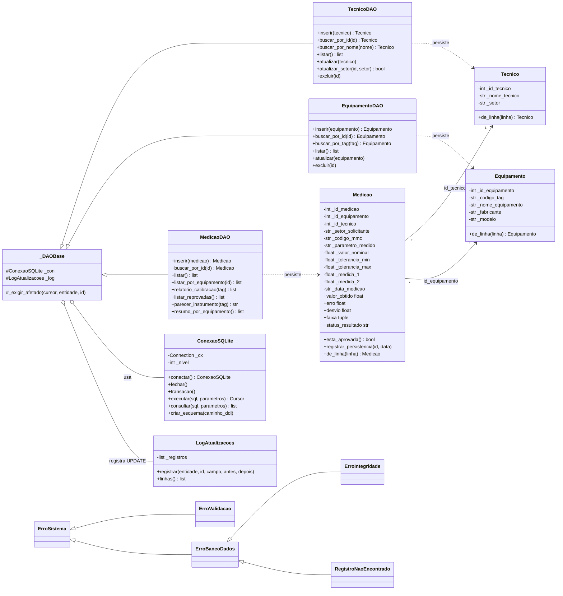

# Projeto Aplicado I - Schulz S.A. - Sistema de Calibração
## Entrega 03 (AV03) - Construção do MVP, Parte 1: Classes em POO (Python) e Conexão com SQLite

**Instituição:** UniSENAI EAD
**Curso:** Superior de Tecnologia em Análise e Desenvolvimento de Sistemas
**Professores:** Prof. MSc. Hugo Menezes Barra e Prof. Rodrigo Losina
**Disciplina:** Projeto Aplicado I
**Alunos:** Anderson Santos da Silva, Arilene de Fátima de Amorim Pacheco, Izaías Lopes Rocha de Sousa, Marco André Flexa Ramos e Josenaldo Santos
**Linguagem e versão:** Python 3 (biblioteca padrão, módulo `sqlite3`). Testado com Python 3.13; recomenda-se 3.10 ou superior. A versão local é conferida com `python --version`.

### 1. Objetivo e Escopo

Esta entrega evolui da modelagem conceitual (Entregas 01 e 02) para a implementação do código do MVP. O objetivo é implementar, em Programação Orientada a Objetos, as classes de domínio `Tecnico`, `Equipamento` e `Medicao`, a camada de conexão e persistência com o banco relacional SQLite e um script de demonstração que insere registros de teste, executa consultas com `JOIN` e exibe o relatório de calibração no terminal.

O código implementa as regras de conferência metrológica da Entrega 01 (RN-04, RN-08 e RN-09) sobre o esquema de banco da Entrega 02. A importação do relatório do Calypso, o cálculo de incerteza e a geração do certificado em PDF ficam para a Parte 2 do MVP.

**Esquema de dados utilizado.** O MVP usa a versão revisada do esquema da Entrega 02, entregue junto com o código (`03_banco.sql`). Em relação à versão anterior, o esquema remove o campo redundante `codigo` de `medicao`, inclui `setor_solicitante`, `codigo_mmc`, `medida_1` e `medida_2`, torna `status_resultado` obrigatório, aceita fabricante e modelo nulos em `equipamento` e protege os campos derivados com restrições `CHECK`.

**Dados de teste.** As duas primeiras medições usam valores reais das planilhas da Schulz (Entrega 01). As demais são simuladas (o nome do parâmetro contém `SIMULADO`) e existem para exercitar os casos reprovado e de limite da tolerância, pois o material real não traz uma medição reprovada.

### 2. Estrutura do Projeto e Execução

| Arquivo | Função |
|---|---|
| `03_banco.sql` | Script DDL do esquema (3 tabelas), reaproveitado da Entrega 02 revisada |
| `03b_dados_exemplo.sql` | Dados de exemplo (carga inicial opcional), da Entrega 02 revisada |
| `04_classes.py` | Classes de domínio, conexão, persistência (DAOs), log de atualizações e exceções |
| `05_main.py` | Script de demonstração e relatório de calibração |
| `06_mvp_parte1.md` | Esta documentação técnica |
| `07_testes.py` | 33 testes automatizados (`unittest`) |
| `diagrama_classes.mmd` / `.png` | Diagrama UML de classes (código Mermaid e imagem) |
| `schulz_calibracao.db` e `schulz_atualizacoes.log` | Gerados pelo `05_main.py` (não são versionados: `.gitignore`) |

Execução (a partir da pasta do projeto, sem dependências externas):

```text
python 05_main.py                  # recria o banco do zero e exibe a demonstração
python -m unittest 07_testes.py -v # executa os testes automatizados
```

Como o roteiro exige o nome `04_classes.py` (iniciado por dígito, o que impede `import 04_classes`), o script principal importa o módulo com `importlib.import_module("04_classes")`.

### 3. Padrões de POO Utilizados

| Conceito ou padrão | Onde aparece | Finalidade |
|---|---|---|
| **Encapsulamento** | Atributos privados (`_nome_tecnico`, `_medida_1`...) expostos por `property`; setters com validação em `Tecnico` e `Equipamento` | Impede estado inválido: nenhum objeto é criado ou alterado com dado fora das regras |
| **Imutabilidade** | `Medicao` não tem setters | Preserva o ensaio registrado (rastreabilidade, seção 6) |
| **Valores derivados** | `Medicao.valor_obtido`, `erro`, `desvio`, `faixa` e `status_resultado` | Média, erro e status são sempre calculados; nunca informados |
| **Abstração e separação de responsabilidades** | Domínio, persistência (`ConexaoSQLite` e DAOs) e apresentação (`05_main.py`) em camadas distintas | O domínio não conhece SQL; trocar o banco afeta apenas a camada de persistência |
| **Herança** | `_DAOBase` (base dos três DAOs); hierarquia de exceções (`ErroSistema` e derivadas) | Reaproveita conexão, log e tratamento de registro inexistente; permite capturar erros por categoria |
| **Composição** | Cada DAO recebe uma `ConexaoSQLite` e um `LogAtualizacoes` | Todos compartilham a mesma conexão, a mesma transação e o mesmo log |
| **DAO (Data Access Object)** | `TecnicoDAO`, `EquipamentoDAO`, `MedicaoDAO` | Concentra o SQL de cada entidade e devolve objetos de domínio |
| **Método de fábrica** | `Tecnico.de_linha`, `Equipamento.de_linha`, `Medicao.de_linha` | Reconstrói o objeto a partir de uma linha do banco, revalidando os dados |
| **Gerenciador de contexto** | `ConexaoSQLite` (`with`) e `ConexaoSQLite.transacao()` | Garante fechamento da conexão e `COMMIT` ou `ROLLBACK` automáticos |
| **Exceções personalizadas** | `ErroValidacao`, `ErroBancoDados`, `ErroIntegridade`, `RegistroNaoEncontrado` | Traduz falhas técnicas em erros de domínio com mensagem legível |

### 4. Diagrama de Classes (UML)



O mesmo diagrama está na imagem `diagrama_classes.png` (e o código-fonte em `diagrama_classes.mmd`).

Representação textual das relações:

```text
Medicao  *---1  Tecnico         (medicao.id_tecnico -> tecnico.id_tecnico)
Medicao  *---1  Equipamento     (medicao.id_equipamento -> equipamento.id_equipamento)
TecnicoDAO, EquipamentoDAO, MedicaoDAO  --herdam-->  _DAOBase  --usa-->  ConexaoSQLite, LogAtualizacoes
TecnicoDAO ..persiste..> Tecnico   EquipamentoDAO ..persiste..> Equipamento   MedicaoDAO ..persiste..> Medicao
ErroSistema <- ErroValidacao
ErroSistema <- ErroBancoDados <- ErroIntegridade, RegistroNaoEncontrado
```

### 5. Regras de Negócio e Coerência Matemática

| Regra | Origem | Implementação em `04_classes.py` |
|---|---|---|
| Resultado é a média de duas medições | RN-04 (Entrega 01) | `Medicao.valor_obtido = (medida_1 + medida_2) / 2` |
| Erro é o valor absoluto da diferença para o nominal | RN-09 (Entrega 01) | `Medicao.erro = abs(valor_obtido - valor_nominal)` |
| Aprovação por tolerância | Critério do MVP | `Medicao.esta_aprovada()`: aprovado se o valor obtido está dentro da faixa, com margem `EPSILON` |
| Normalização do código da MMC | ETL-10 (Entrega 01) | `500.011` vira `500011` |
| Placeholders de planilha viram nulo | ETL-11 (Entrega 01) | "Não consta", "Não se aplica" e "---" viram `None` |
| Limpeza de texto e TAG | ETL-15 (Entrega 01) | Normaliza Unicode e espaços; a TAG fica sem espaços nas pontas e em maiúsculas |

**Notação.** Seja `n` o valor nominal, `t-` e `t+` as tolerâncias como desvios em relação ao nominal (com `t- <= 0 <= t+`), `m1` e `m2` as duas medições e `eps = 1e-7` a margem numérica.

- Valor obtido: `x = (m1 + m2) / 2`.
- Desvio (com sinal): `d = x - n`. Erro (RN-09): `e = |d|`.
- Faixa aceitável: `[L_inf ; L_sup] = [n + t- ; n + t+]`.

**Equivalência entre desvios e limites absolutos.** A condição de aprovação por limites absolutos é `L_inf - eps <= x <= L_sup + eps`. Subtraindo `n` dos três membros, obtém-se `t- - eps <= x - n <= t+ + eps`, isto é, `t- - eps <= d <= t+ + eps`. As duas formulações são matematicamente idênticas e produzem sempre o mesmo resultado. Por isso, guardar as tolerâncias como desvios (como o Calypso as fornece, em *Upper Tol* e *Lower Tol*) ou como limites absolutos não altera nenhuma decisão. O grupo manteve os desvios porque evita uma conversão na importação (uma fonte de erro a menos) e preserva o nominal como referência, e mostra a faixa `[L_inf ; L_sup]` no relatório, que é a leitura natural do técnico. O teste `test_equivalencia_desvio_e_limites_absolutos` verifica a equivalência numericamente.

| Parâmetro | n | t- | t+ | Faixa `[L_inf ; L_sup]` |
|---|---|---|---|---|
| 62P_DIAMETRO_2 | 6,075 | -0,010 | +0,010 | [6,065 ; 6,085] |
| PLANICIDADE_REF | 0,000 | 0,000 | +0,050 | [0,000 ; 0,050] |

**Por que a aprovação compara o valor obtido com os limites, e não o erro com a tolerância.** Comparar `e = |d|` com uma única tolerância só é correto quando `t- = -t+`. Em PLANICIDADE_REF (`t- = 0`, `t+ = 0,05`), um valor `x = -0,001` tem erro `0,001 <= 0,05`, o que o aprovaria, mas `x` está abaixo de `L_inf = 0`, e a decisão correta é REPROVADO. Com a comparação por limites (equivalente a `d` em `[t- ; t+]`), o resultado é correto para qualquer tolerância, simétrica ou assimétrica.

**Erro em módulo e desvio com sinal.** O erro segue a RN-09 (`e = |d|`) e informa a magnitude da diferença. O guia da AV03 define o erro com sinal (`valor obtido - valor nominal`); essa informação é preservada na propriedade `desvio`, mostrada no relatório com sinal. Como `e = |d|`, as duas grandezas são coerentes entre si, e a decisão de aprovação não depende do erro, apenas da faixa.

**Margem numérica.** Números reais são guardados em ponto flutuante (por exemplo, `0.1 + 0.2` resulta em `0.30000000000000004`). Sem margem, uma medição exatamente sobre o limite poderia ser reprovada por erro de arredondamento. Por isso os limites são inclusivos, com `eps = 1e-7` (mesma margem da Aula 02). O `CHECK` de `status_resultado` no `03_banco.sql` usa a mesma fórmula e a mesma margem, e os testes cobrem os dois limites (`6,085` e `6,065`).

### 6. Imutabilidade da Medição e Log de Atualizações

**Imutabilidade.** `Medicao` não possui setters: depois de criada, nenhum atributo pode ser atribuído (a tentativa gera `AttributeError`), e o `MedicaoDAO` não oferece `atualizar` nem `excluir`. A justificativa é a rastreabilidade: um ensaio de calibração é registro de qualidade da Schulz, e a regra RN-08 da Entrega 01 determina que o certificado emitido não muda e que um erro exige anulação com justificativa e nova emissão. Se uma medição foi digitada errada, registra-se um novo ensaio e o original permanece no histórico. Os campos derivados também estão protegidos no banco pelos `CHECK` do `03_banco.sql`, de modo que um `UPDATE` direto que torne o status incoerente é recusado.

**Log de atualizações.** As entidades cadastrais (`tecnico` e `equipamento`) podem ser alteradas, e toda alteração é auditada pela classe `LogAtualizacoes`: para cada campo modificado grava-se data e hora, entidade, id, campo, valor anterior e valor novo. O log fica em memória (`log.registros`) e no arquivo `schulz_atualizacoes.log`. Um `UPDATE` que não muda nenhum valor não gera registro.

```text
2026-11-20 20:12:11 | UPDATE tecnico id=1 | setor: 'Metrologia' -> 'Qualidade'
```

Limitação: o log é um arquivo de texto e não identifica o usuário, porque o MVP ainda não tem autenticação (RF-17). Na Parte 2, o log pode migrar para uma tabela de auditoria com o usuário responsável.

**Id definido uma única vez.** O DAO precisa gravar no objeto o id gerado pelo banco. Para não quebrar o encapsulamento, o id de `Tecnico` e `Equipamento` só aceita atribuição uma vez, e `Medicao` recebe id e data por `registrar_persistencia`, também uma única vez. Uma segunda tentativa gera `ErroValidacao`.

### 7. Persistência com SQLite

**Conexão.** `ConexaoSQLite.conectar()` abre o banco, ativa `PRAGMA foreign_keys = ON` e confirma a ativação, pois no SQLite esse comando vale por conexão. Sem ele, as chaves estrangeiras seriam ignoradas mesmo com o DDL correto. A classe também controla transações explicitamente (`BEGIN`, `COMMIT` e `ROLLBACK`), com suporte a transações aninhadas.

**Operações por DAO.**

| Operação | SQL | Métodos |
|---|---|---|
| Create | `INSERT` | `TecnicoDAO.inserir`, `EquipamentoDAO.inserir`, `MedicaoDAO.inserir` |
| Read | `SELECT` | `buscar_por_id`, `buscar_por_nome`, `buscar_por_tag`, `listar`, `listar_por_equipamento`, `listar_reprovadas`, `parecer_instrumento` |
| Update | `UPDATE` | `TecnicoDAO.atualizar` e `atualizar_setor`, `EquipamentoDAO.atualizar` (com log); a medição não é atualizada |
| Delete | `DELETE` | `TecnicoDAO.excluir` e `EquipamentoDAO.excluir` (bloqueados por `ON DELETE RESTRICT` quando há medições vinculadas) |

**Padrão DAO.** Cada entidade tem uma classe própria que conversa com o banco. Se a Schulz pedir para trocar o SQLite por outro banco, só a camada de persistência (`ConexaoSQLite` e os DAOs) muda; as classes de domínio e as regras de negócio permanecem iguais.

**Proteção contra SQL Injection.** Todas as consultas usam parâmetros (`?`), nunca concatenação de texto. O script demonstra a busca com o texto `' OR '1'='1`, que é tratado como dado e não retorna registro. Com concatenação, esse texto alteraria a lógica do comando e devolveria todos os registros.

**Consulta relacional (JOIN).** O relatório de calibração une as três tabelas. A faixa e o desvio são calculados na própria consulta:

```sql
SELECT m.id_medicao, e.codigo_tag, e.nome_equipamento, t.nome_tecnico, m.setor_solicitante,
       m.codigo_mmc, m.parametro_medido, m.valor_nominal, m.tolerancia_min, m.tolerancia_max,
       m.valor_nominal + m.tolerancia_min AS limite_min, m.valor_nominal + m.tolerancia_max AS limite_max,
       m.medida_1, m.medida_2, m.valor_obtido, m.valor_obtido - m.valor_nominal AS desvio,
       m.erro, m.status_resultado, m.data_medicao
FROM medicao m
JOIN equipamento e ON e.id_equipamento = m.id_equipamento
JOIN tecnico t ON t.id_tecnico = m.id_tecnico
[WHERE e.codigo_tag = ?]
ORDER BY e.codigo_tag, m.data_medicao, m.id_medicao
```

O parecer do instrumento é APROVADO somente se todas as suas medições forem aprovadas. O resumo por equipamento usa `LEFT JOIN` e `GROUP BY` e inclui equipamentos sem medição.

### 8. Tratamento de Erros SQL

O método `_traduzir_erro` converte as exceções do `sqlite3` em exceções de domínio, e a transação desfaz automaticamente as alterações quando ocorre falha.

| Situação | Exceção do sqlite3 | Exceção do sistema | Camada que detecta |
|---|---|---|---|
| Medição para técnico ou equipamento inexistente | `IntegrityError` (FOREIGN KEY) | `ErroIntegridade` | Banco |
| TAG ou nome de técnico duplicado (mesmo com espaços ou minúsculas) | `IntegrityError` (UNIQUE) | `ErroIntegridade` | Classe (padroniza) e banco (UNIQUE) |
| Excluir técnico ou equipamento com medições | `IntegrityError` (FOREIGN KEY, RESTRICT) | `ErroIntegridade` | Banco |
| Campo obrigatório ausente ou registro viola `CHECK` | `IntegrityError` (NOT NULL ou CHECK) | `ErroIntegridade` | Banco |
| Tolerâncias invertidas, valor não numérico, texto vazio, data inválida | não chega ao banco | `ErroValidacao` | Classes de domínio |
| Alterar uma medição registrada | não chega ao banco | `AttributeError` (sem setter) | Classe `Medicao` |
| Atualizar ou excluir registro inexistente | `rowcount == 0` | `RegistroNaoEncontrado` | DAO |
| Script DDL ausente ou conexão fechada | `OSError` | `ErroBancoDados` | Conexão |
| Falha em transação | qualquer `sqlite3.Error` | `ROLLBACK` e `ErroBancoDados` | Conexão |

**Defesa em camadas.** A validação ocorre em duas camadas que se complementam, e a repetição entre elas é intencional. As classes de domínio recusam dados inválidos antes de qualquer acesso ao banco e dão mensagens claras ao operador. As restrições do esquema (`NOT NULL`, `UNIQUE`, `FOREIGN KEY` e `CHECK`) são a barreira final: protegem os dados mesmo de acessos que não passem pelas classes (outro programa, um `UPDATE` manual no DB Browser, uma importação futura).

### 9. Validação do Fluxo Funcional

**Testes automatizados** (`07_testes.py`, 33 testes): cobrem média, erro e desvio com valores reais da Schulz; aprovação e reprovação acima e abaixo da faixa; limites inclusivos; tolerância assimétrica; a equivalência entre desvios e limites absolutos; imutabilidade da `Medicao`; id definido uma única vez; normalização da TAG, da MMC e do texto; validações de domínio; inserção e leitura de medição; ausência de `atualizar` e `excluir` em `MedicaoDAO`; recusa pelo banco de um `UPDATE` incoerente; log de atualizações (em memória e em arquivo); chaves estrangeiras ativas; TAG duplicada; exclusão bloqueada; rollback; `JOIN`, resumo e parecer; e tentativa de injeção de SQL.

```saida
test_campos_obrigatorios (07_testes.TestDominio.test_campos_obrigatorios) ... ok
test_id_definido_uma_unica_vez (07_testes.TestDominio.test_id_definido_uma_unica_vez) ... ok
test_placeholders_viram_none (07_testes.TestDominio.test_placeholders_viram_none) ... ok
test_tag_padronizada (07_testes.TestDominio.test_tag_padronizada) ... ok
test_texto_normalizado (07_testes.TestDominio.test_texto_normalizado) ... ok
test_equivalencia_desvio_e_limites_absolutos (07_testes.TestMedicao.test_equivalencia_desvio_e_limites_absolutos)
Coerência matemática: |x - nominal| dentro de [Tol-, Tol+] equivale a x dentro de [nominal+Tol-, nominal+Tol+]. ... ok
test_erro_em_modulo_e_desvio_com_sinal (07_testes.TestMedicao.test_erro_em_modulo_e_desvio_com_sinal) ... ok
test_faixa_aceitavel (07_testes.TestMedicao.test_faixa_aceitavel) ... ok
test_imutabilidade (07_testes.TestMedicao.test_imutabilidade) ... ok
test_limites_sao_inclusivos (07_testes.TestMedicao.test_limites_sao_inclusivos) ... ok
test_media_erro_e_desvio_do_exemplo_real (07_testes.TestMedicao.test_media_erro_e_desvio_do_exemplo_real) ... ok
test_mmc_normalizada_e_virgula_decimal (07_testes.TestMedicao.test_mmc_normalizada_e_virgula_decimal) ... ok
test_registrar_persistencia_so_uma_vez (07_testes.TestMedicao.test_registrar_persistencia_so_uma_vez) ... ok
test_reprovado_acima_e_abaixo (07_testes.TestMedicao.test_reprovado_acima_e_abaixo) ... ok
test_tolerancia_assimetrica (07_testes.TestMedicao.test_tolerancia_assimetrica) ... ok
test_validacoes (07_testes.TestMedicao.test_validacoes) ... ok
test_banco_rejeita_update_incoerente_na_medicao (07_testes.TestPersistencia.test_banco_rejeita_update_incoerente_na_medicao) ... ok
test_buscar_tag_padronizada (07_testes.TestPersistencia.test_buscar_tag_padronizada) ... ok
test_chaves_estrangeiras_ativas (07_testes.TestPersistencia.test_chaves_estrangeiras_ativas) ... ok
test_excluir_tecnico_com_medicao_e_bloqueado (07_testes.TestPersistencia.test_excluir_tecnico_com_medicao_e_bloqueado) ... ok
test_fk_inexistente (07_testes.TestPersistencia.test_fk_inexistente) ... ok
test_injecao_sql_tratada_como_dado (07_testes.TestPersistencia.test_injecao_sql_tratada_como_dado) ... ok
test_inserir_e_ler_medicao (07_testes.TestPersistencia.test_inserir_e_ler_medicao) ... ok
test_join_resumo_e_parecer (07_testes.TestPersistencia.test_join_resumo_e_parecer) ... ok
test_log_em_arquivo (07_testes.TestPersistencia.test_log_em_arquivo) ... ok
test_medicao_dao_sem_atualizar_nem_excluir (07_testes.TestPersistencia.test_medicao_dao_sem_atualizar_nem_excluir) ... ok
test_parecer_aprovado_quando_todas_aprovadas (07_testes.TestPersistencia.test_parecer_aprovado_quando_todas_aprovadas) ... ok
test_rollback_da_transacao (07_testes.TestPersistencia.test_rollback_da_transacao) ... ok
test_tag_duplicada_mesmo_com_espaco_e_minuscula (07_testes.TestPersistencia.test_tag_duplicada_mesmo_com_espaco_e_minuscula) ... ok
test_update_equipamento_registra_cada_campo_alterado (07_testes.TestPersistencia.test_update_equipamento_registra_cada_campo_alterado) ... ok
test_update_inexistente (07_testes.TestPersistencia.test_update_inexistente) ... ok
test_update_sem_mudanca_nao_gera_log (07_testes.TestPersistencia.test_update_sem_mudanca_nao_gera_log) ... ok
test_update_tecnico_gera_log (07_testes.TestPersistencia.test_update_tecnico_gera_log) ... ok

----------------------------------------------------------------------
Ran 33 tests in 0.010s

OK
```

**Execução da demonstração** (`python 05_main.py`). O fluxo percorre: criação do banco; instanciação e inserção de dois técnicos, dois equipamentos e cinco medições (dentro da faixa, fora, e exatamente sobre o limite superior); relatório com `JOIN` e parecer final do instrumento; resumo por equipamento; consulta parametrizada e tentativa de SQL Injection; `UPDATE` com log; imutabilidade da medição; sete erros capturados; transação com `ROLLBACK`; e relatório final.

```saida
====================================================================================================
1. Criação do banco (03_banco.sql) e conexão
====================================================================================================
Banco: schulz_calibracao.db | Tabelas: equipamento, medicao, tecnico | PRAGMA foreign_keys = 1

====================================================================================================
2. Instanciação dos objetos e inserção de registros de teste (INSERT)
====================================================================================================
Tecnico(id=1, nome='Jose Alcides Rosa Junior', setor='Metrologia')
Tecnico(id=2, nome='Cleocir de Souza', setor='Metrologia')
Equipamento(id=1, tag='703.1208', nome='Dispositivo de controle')  (fabricante=None, modelo=None; 'Não consta' virou None)
Equipamento(id=2, tag='TESTE-001', nome='Calibrador fictício de teste')  (TAG ' teste-001 ' padronizada para 'TESTE-001')
id=1  62P_DIAMETRO_2: obtido 6.078 | faixa [6.065 ; 6.085] | desvio +0.003 | erro 0.003 -> APROVADO
id=2  PLANICIDADE_REF: obtido 0.002 | faixa [0.000 ; 0.050] | desvio +0.002 | erro 0.002 -> APROVADO
id=3  62P_DIAMETRO_SIMULADO: obtido 6.095 | faixa [6.065 ; 6.085] | desvio +0.020 | erro 0.020 -> REPROVADO
id=4  LIMITE_SUPERIOR_SIMULADO: obtido 6.085 | faixa [6.065 ; 6.085] | desvio +0.010 | erro 0.010 -> APROVADO
id=5  ABAIXO_DO_LIMITE_SIMULADO: obtido 6.060 | faixa [6.065 ; 6.085] | desvio -0.015 | erro 0.015 -> REPROVADO

====================================================================================================
3. Relatório de calibração do instrumento 703.1208 (SELECT com JOIN: medicao + equipamento + tecnico)
====================================================================================================
 ID TAG       Parâmetro                      Técnico                   Faixa aceitável       Obtido   Desvio   Erro  Status   
------------------------------------------------------------------------------------------------------------------------------
  1 703.1208  62P_DIAMETRO_2                 Jose Alcides Rosa Junior  [6.065 ; 6.085]        6.078   +0.003  0.003  APROVADO 
  2 703.1208  PLANICIDADE_REF                Jose Alcides Rosa Junior  [0.000 ; 0.050]        0.002   +0.002  0.002  APROVADO 
  3 703.1208  62P_DIAMETRO_SIMULADO          Cleocir de Souza          [6.065 ; 6.085]        6.095   +0.020  0.020  REPROVADO

Parecer final do instrumento 703.1208: REPROVADO  (APROVADO só se todas as medições forem aprovadas)

====================================================================================================
4. Resumo e parecer por equipamento (LEFT JOIN + GROUP BY)
====================================================================================================
TAG        Equipamento                      Total Aprov. Reprov.  Parecer
703.1208   Dispositivo de controle              3      2       1  REPROVADO
TESTE-001  Calibrador fictício de teste         2      1       1  REPROVADO

====================================================================================================
5. Consulta parametrizada: TAG digitada em minúsculas e tentativa de SQL Injection
====================================================================================================
Busca por ' 703.1208 ': Equipamento(id=1, tag='703.1208', nome='Dispositivo de controle')
Busca por ' teste-001': Equipamento(id=2, tag='TESTE-001', nome='Calibrador fictício de teste')  (padronizada com strip + maiúsculas)
Busca com texto malicioso "' OR '1'='1": None (parâmetro tratado como dado, não como SQL)

====================================================================================================
6. Atualização (UPDATE) com log: cada campo alterado é registrado (antes -> depois)
====================================================================================================
UPDATE do setor do técnico: True | agora: Tecnico(id=1, nome='Jose Alcides Rosa Junior', setor='Qualidade')
UPDATE do equipamento: Equipamento(id=1, tag='703.1208', nome='Dispositivo de controle dimensional') (fabricante=Schulz)

Log de atualizações (schulz_atualizacoes.log):
  2026-11-20 20:12:49 | UPDATE tecnico id=1 | setor: 'Metrologia' -> 'Qualidade'
  2026-11-20 20:12:49 | UPDATE equipamento id=1 | nome_equipamento: 'Dispositivo de controle' -> 'Dispositivo de controle dimensional'
  2026-11-20 20:12:49 | UPDATE equipamento id=1 | fabricante: None -> 'Schulz'
  2026-11-20 20:12:49 | UPDATE tecnico id=1 | setor: 'Qualidade' -> 'Metrologia'

====================================================================================================
7. Imutabilidade da medição (rastreabilidade): um ensaio registrado não pode ser alterado
====================================================================================================
  [OK] Alterar medida_1 de uma medição registrada
       -> AttributeError: property 'medida_1' of 'Medicao' object has no setter
  [OK] Digitar o status_resultado (é calculado, não atribuído)
       -> AttributeError: property 'status_resultado' of 'Medicao' object has no setter
  [OK] Registrar de novo uma medição já gravada
       -> ErroValidacao: A medição já foi registrada e não pode ser alterada.
  Medição 3 permanece: REPROVADO. Para corrigir um ensaio, registra-se um novo ensaio; o original fica no histórico.

====================================================================================================
8. Tratamento de erros (cada operação abaixo deve ser recusada)
====================================================================================================
  [OK] Medição para equipamento inexistente (violação de FK)
       -> ErroIntegridade: Violação de chave estrangeira: registro relacionado inexistente ou ainda referenciado por outros registros.
  [OK] Mesma TAG digitada com espaço e minúsculas (padronização + UNIQUE)
       -> ErroIntegridade: Registro duplicado (equipamento.codigo_tag).
  [OK] Tolerâncias invertidas (validação de domínio, antes do banco)
       -> ErroValidacao: Tolerâncias inválidas: exige-se tolerancia_min <= 0 <= tolerancia_max.
  [OK] Valor medido não numérico (validação de domínio)
       -> ErroValidacao: O campo 'medida_1' deve ser numérico (recebido: 'abc').
  [OK] Nome de técnico vazio (validação de domínio)
       -> ErroValidacao: O campo 'nome_tecnico' é obrigatório.
  [OK] Excluir técnico que possui medições (ON DELETE RESTRICT)
       -> ErroIntegridade: Violação de chave estrangeira: registro relacionado inexistente ou ainda referenciado por outros registros.
  [OK] Atualizar técnico inexistente
       -> RegistroNaoEncontrado: Técnico com identificador 999 inexistente.
  [OK] atualizar_setor de técnico inexistente devolve: False

====================================================================================================
9. Transação atômica: se a segunda inserção falhar, a primeira é desfeita (ROLLBACK)
====================================================================================================
  Falha capturada: Violação de chave estrangeira: registro relacionado inexistente ou ainda referenciado por outros registros.
  Medições antes: 5 | depois: 5 (a primeira inserção foi desfeita)

====================================================================================================
10. Medições reprovadas (todos os equipamentos) e relatório geral
====================================================================================================
 ID TAG       Parâmetro                      Técnico                   Faixa aceitável       Obtido   Desvio   Erro  Status   
------------------------------------------------------------------------------------------------------------------------------
  3 703.1208  62P_DIAMETRO_SIMULADO          Cleocir de Souza          [6.065 ; 6.085]        6.095   +0.020  0.020  REPROVADO
  5 TESTE-001 ABAIXO_DO_LIMITE_SIMULADO      Jose Alcides Rosa Junior  [6.065 ; 6.085]        6.060   -0.015  0.015  REPROVADO

 ID TAG       Parâmetro                      Técnico                   Faixa aceitável       Obtido   Desvio   Erro  Status   
------------------------------------------------------------------------------------------------------------------------------
  1 703.1208  62P_DIAMETRO_2                 Jose Alcides Rosa Junior  [6.065 ; 6.085]        6.078   +0.003  0.003  APROVADO 
  2 703.1208  PLANICIDADE_REF                Jose Alcides Rosa Junior  [0.000 ; 0.050]        0.002   +0.002  0.002  APROVADO 
  3 703.1208  62P_DIAMETRO_SIMULADO          Cleocir de Souza          [6.065 ; 6.085]        6.095   +0.020  0.020  REPROVADO
  4 TESTE-001 LIMITE_SUPERIOR_SIMULADO       Cleocir de Souza          [6.065 ; 6.085]        6.085   +0.010  0.010  APROVADO 
  5 TESTE-001 ABAIXO_DO_LIMITE_SIMULADO      Jose Alcides Rosa Junior  [6.065 ; 6.085]        6.060   -0.015  0.015  REPROVADO

Execução concluída sem erros inesperados.
```

### 10. Limitações e Próximos Passos

- A entrada de dados do MVP é feita por código. A importação do relatório do Calypso com as regras ETL (Entrega 01) fica para a Parte 2.
- O cálculo da incerteza expandida, a geração do certificado em PDF, a numeração sequencial e o controle de usuários e perfis (RF-04, RF-05, RF-06 e RF-17) não fazem parte desta etapa.
- O modelo de dados tem três tabelas, conforme o roteiro da Entrega 02. As demais entidades do modelo unificado da Entrega 01 (MMC, cliente interno, signatário, log de auditoria) serão incorporadas quando o escopo crescer.
- O log de atualizações ainda não identifica o usuário (depende da autenticação).

### 11. Conclusão do Entregável

Esta entrega implementou o núcleo do MVP em Python: três classes de domínio com encapsulamento e validação, uma camada de persistência com conexão gerenciada, transações, DAOs, consultas relacionais com `JOIN` e tratamento estruturado de erros SQL. A modelagem foi construída sobre o esquema revisado da Entrega 02, que eliminou a redundância e as inconsistências identificadas anteriormente. As regras metrológicas (média de duas medições, erro absoluto e aprovação por faixa de tolerância) têm coerência matemática demonstrada e verificada por 33 testes automatizados. A medição é imutável, preservando a rastreabilidade, e as alterações cadastrais são auditadas em log. O resultado atende aos critérios de qualidade da modelagem POO, tratamento correto dos dados com o SQLite, alinhamento aos requisitos do projeto e organização do código, e prepara a Parte 2 do MVP: importação com ETL, cálculo de incerteza e emissão do certificado.
